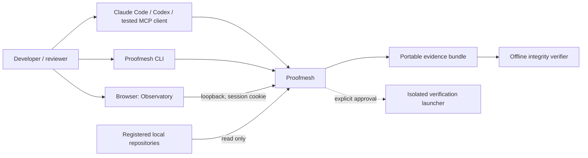
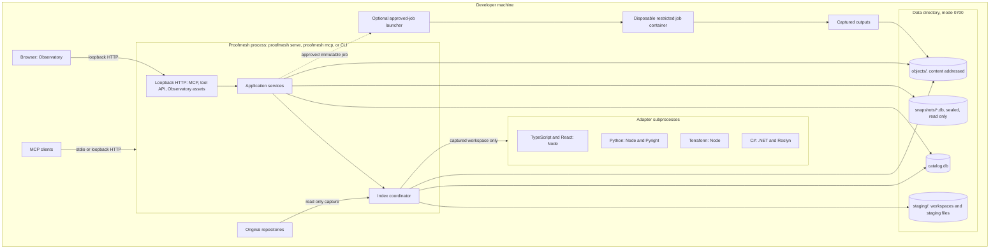
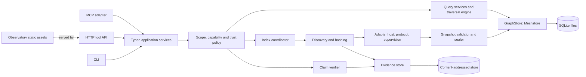
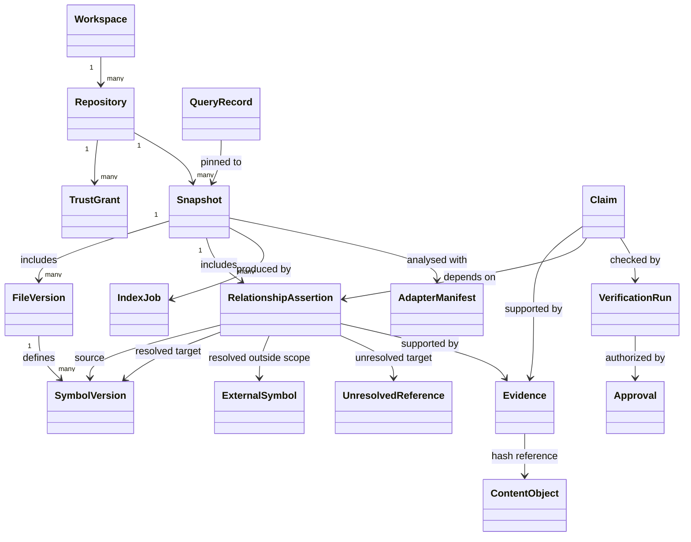
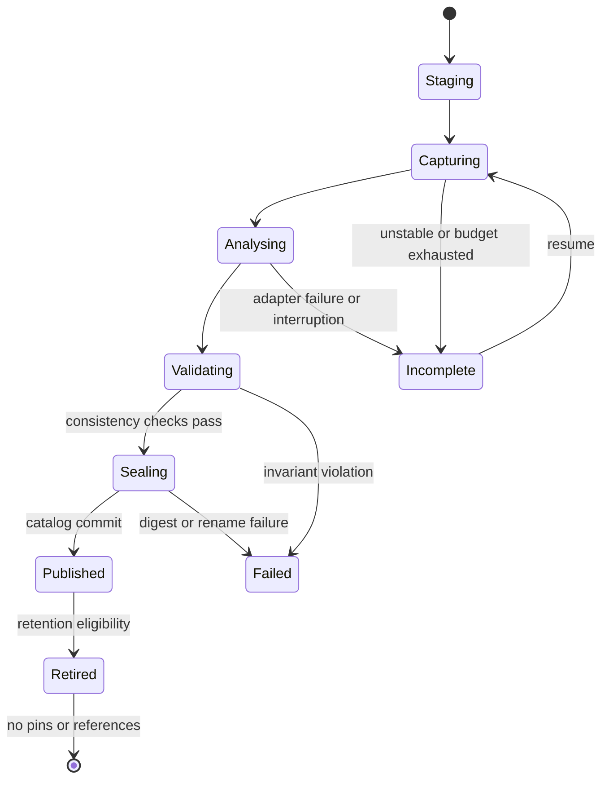
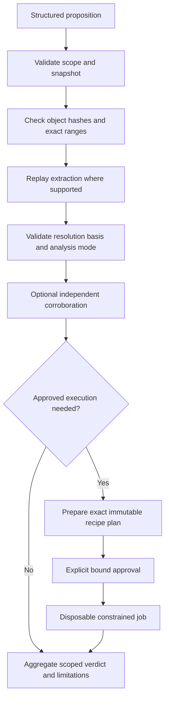
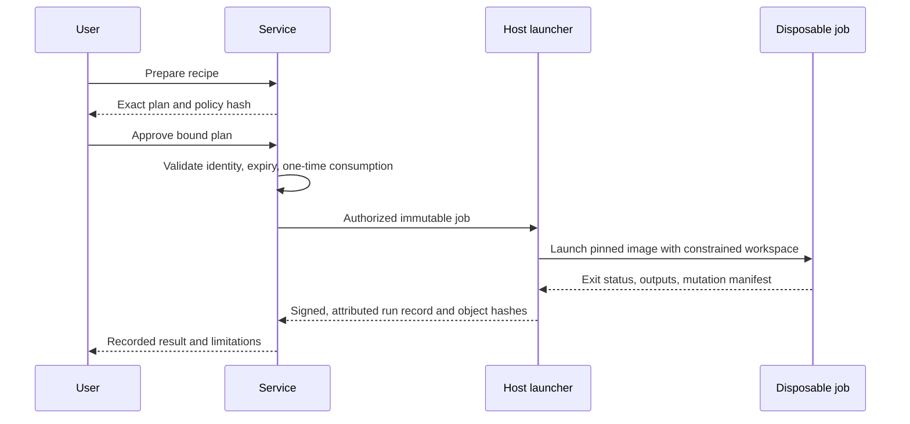

# Proofmesh — Architecture, Contracts, Delivery Plan, and Diagrams

- Status: Proposed implementation plan, revision 3
- Date: 2026-11-07 (revision 1: 2026-11-06)
- Governing documents: ADR-0001 revision 3, the Proofmesh specification revision 3, and `04-proofmesh-m0-walking-skeleton.md` for the first milestone
- Diagram format: Mermaid; text descriptions remain authoritative where a renderer is unavailable
- Commands, ports, tool names, and schemas below are proposed product contracts. M0 contracts are normative in the M0 document.

## 1. System context



Proofmesh supplies code evidence to an agent and a picture of that evidence to a person. It does not host a language model. The offline verifier checks bundle integrity without a running service; semantic revalidation may require source and toolchains.

## 2. Processes and trust boundaries



Boundaries:

- The repository is read only. The coordinator copies captured content into the evidence store and materializes a staging workspace from it. Adapters see only that workspace.
- Adapters are separate processes with a minimal environment. Only the C# adapter under a trust grant (D14) evaluates build logic, and it does so in its own process.
- The HTTP endpoint binds to loopback and authenticates every request. Observatory has no capability beyond the tool API.
- The service never talks to a container runtime; only the launcher does, and it is disabled by default.
- Any number of reader processes may share a data directory. Index coordination is serialized by a catalog lease.

In the OCI image, the same process runs inside one container with repositories mounted read only, the data directory on a volume, and only the loopback port published.

## 3. Internal components



Transport handlers contain no graph semantics or authorization shortcuts. CLI, MCP, and the HTTP tool API call the same service methods with the same JSON Schema contracts. SQL is parameterized; snapshot scoping is structural (one sealed file per query).

## 4. Technology stack

Versions are pinned at implementation time and recorded in `research.md` with their licenses. "Verify" marks a fact to confirm when pinning.

| Concern | Choice | License | Notes |
|---|---|---|---|
| Core runtime | Node.js LTS, ESM, TypeScript strict | MIT, Apache-2.0 | Engines `>=22.13`; CI on the active LTS releases |
| Package management | pnpm workspaces | MIT | Matches the maintainer's other TypeScript projects |
| SQLite binding | better-sqlite3 (bundles SQLite) | MIT; SQLite public domain | Verify FTS5, JSON, STRICT tables in the bundled build; readiness checks them |
| Schemas | JSON Schema 2020-12 in `schemas/`, validated with Ajv | MIT | Language neutral, so the .NET adapter shares them; TypeScript types generated and drift-checked |
| MCP | `@modelcontextprotocol/sdk` | MIT | Pin protocol revision in the release manifest |
| TypeScript adapter | `typescript` 6.x compiler API | Apache-2.0 | 7.x dropped the classic API; programs built from the captured workspace; no language-service plugins |
| React adapter | Same process as the TypeScript adapter, framework rules over its facts | Apache-2.0 | Separate manifest and capability statement |
| Python adapter | Pyright, driven by the adapter process | MIT | Spike first: integration surface and throughput |
| Terraform adapter | Tree-sitter HCL grammar through web-tree-sitter, own resolver | Verify grammar license | No `terraform init` |
| C# adapter | .NET with Roslyn, re-hosted from the predecessor | MIT | Two modes per D14 |
| Observatory | React, Vite, Sigma.js, graphology, cosmos.gl | MIT | cosmos.gl only for Galaxy, after its spike |
| Tests | Vitest, fast-check, Playwright, axe-core, Stryker | MIT, Apache-2.0, MPL-2.0 | Stryker is a development dependency only; MPL-2.0 is not in distributed artifacts |
| Formatting | Prettier, `tsc --noEmit` | MIT | Lint rules can come later |
| Builds | esbuild for the CLI bundle, Vite for Observatory | MIT | |

## 5. Graph model and Meshstore

### Logical model



### Files on disk

```text
<data-dir>/                     default ~/.proofmesh, mode 0700
  catalog.db                    WAL; mutable registry
  snapshots/<snapshot-id>.db    sealed, mode 0444, digest in catalog
  objects/sha256/<aa>/<bb>/<hash>
  staging/<snapshot-id>/        staging file and materialized workspace; removed after publish or failure
  tokens/                       API and session secrets, mode 0600
```

### Snapshot file (illustrative; normative M0 subset in the M0 document)

```sql
meta(key, value)                                        -- format version, identity, analysis mode, adapters
file(id, path, content_hash, size, language, disposition, disposition_detail, capabilities)
symbol(id, file_id, kind, name, qualified_name, start_byte, end_byte, start_line, end_line,
       signature, stable_key, evidence_id)
external_symbol(id, module, name)
evidence(id, object_hash, start_byte, end_byte, start_line, end_line, source_kind,
         extractor, extractor_version, analysis_mode)
assertion(id, type, origin, resolution, source_kind, source_id, target_kind, target_id,
          reason, adapter, adapter_version, analysis_mode)
assertion_evidence(assertion_id, evidence_id)
assertion_candidate(assertion_id, symbol_id, rank, reason)
edge(src, type, dst, resolution, assertion_id)          -- WITHOUT ROWID; indexes (src,type) and (dst,type)
agg_node(id, level, parent_id, label, symbol_count, file_count, coverage)
agg_edge(src_agg, dst_agg, type, resolution, count)
symbol_fts USING fts5(symbol_id UNINDEXED, name, qualified_name, tokenize='trigram')
source_fts USING fts5(file_id UNINDEXED, text, tokenize='trigram')
```

`edge` materializes resolved and resolved-outside-scope assertions for traversal. Candidate, ambiguous, and unresolved assertions stay in `assertion` and `assertion_candidate` and are returned as boundaries. Tests enforce that every `edge` row has a matching assertion with the same resolution.

### Catalog (illustrative)

```sql
repository(id, root, name, created_at)
trust_grant(id, repository_id, mode, granted_by, granted_at, revoked_at)
snapshot(id, repository_id, state, identity_hash, store_digest, analysis_mode, created_at, published_at, failure)
current_snapshot(repository_id, snapshot_id)
index_lease(singleton, owner, expires_at)
index_job(id, repository_id, snapshot_id, state, checkpoint, started_at, finished_at)
claim(...), verification_run(...), approval(...), memory_note(...), query_record(...)
schema_migration(version, applied_at)
```

### Snapshot identity and IDs

Snapshot identity is the SHA-256 of a canonical JSON document holding the repository ID, the inventory manifest hash, the analysis configuration hash, the analysis mode, the adapter manifests, and the snapshot format version. `snapshot_id = "snap_" + first 24 hex characters`. Re-indexing identical inputs yields the same ID, and Proofmesh reuses the published snapshot instead of creating a new file.

Symbol, evidence, and assertion IDs are derived hashes scoped to the snapshot. `stable_key` (`path#qualified_name#kind`) supports best-effort continuity across snapshots for layout and comparison, and is never used as identity.

### Traversal engine

- Level-synchronous breadth-first expansion. Each level issues one batched indexed query over `edge` for the whole frontier (chunked to the SQLite parameter limit).
- Budgets checked between batches: depth, rows, bytes of the serialized result, and wall-clock deadline. The first exhausted budget is reported as the stop reason, and the current frontier becomes the horizon.
- Filters: relationship types, resolutions (default `resolved`), direction.
- Path search returns all shortest paths up to `max_rows`, and its conclusion is one of `path_found`, `no_path_within_bounds` (a budget stopped it), `no_resolved_path` (the resolved graph was exhausted but the explored region contains unresolved or candidate sites that could lead on), or `no_path_exhaustive` (exhausted with no such sites, within the declared relationship types and analysis mode).
- An in-memory graphology implementation of the same functions is the differential test oracle.

## 6. Snapshot state machine



Only `Published` is visible to queries, and only through the catalog. Sealing runs: checkpoint and close the staging file, compute its SHA-256, set mode 0444, rename into `snapshots/`, fsync the directory, then commit `state = published`, `store_digest`, and the current pointer in one catalog transaction. A crash anywhere before that commit leaves the previous pointer in place.

Job completion, snapshot consistency, inventory completeness, and semantic completeness are separate fields. A snapshot with explicitly recorded unsupported semantics may publish; an invariant violation cannot.

## 7. Indexing and publication sequence

```mermaid
sequenceDiagram
  participant C as Coordinator
  participant K as Catalog
  participant F as Repository (read only)
  participant O as Evidence store
  participant W as Staging workspace and file
  participant A as Adapter processes
  C->>K: Acquire index lease; record job
  C->>F: Discover authorized files, apply rules, hash manifest
  C->>O: Persist and hash-verify each captured file
  C->>W: Materialize workspace from captured objects
  C->>A: initialize(manifest, workspace, mode)
  A-->>C: Adapter manifest
  C->>K: Compute snapshot identity; stop as unchanged if already published
  opt Incremental
    C->>W: Clone previous sealed file; mark invalidated facts
  end
  loop Bounded batches
    C->>A: analyze(batch)
    A-->>C: Symbols, relationships, unresolved sites, diagnostics
    C->>W: Write facts and evidence in one transaction per batch
    C->>K: Checkpoint
  end
  C->>F: Reconcile hashes of captured files
  C->>W: Validate references, ranges, dispositions; build aggregates and FTS
  alt Stable capture and valid publication contract
    C->>W: Seal
    C->>K: Publish and move current pointer
  else Unstable, incomplete or invalid
    C->>K: Record status; keep prior pointer
  end
  C->>K: Release lease
```

Adapters resolve against the materialized workspace, which matches the manifest by construction. If an adapter must read anything outside it (for example installed packages for Python, or restored packages for C# under trust), the paths are declared in the adapter manifest, hashed into snapshot identity where feasible, and reported as an analysis input.

## 8. Query and freshness sequence

```mermaid
sequenceDiagram
  participant A as Agent or Observatory
  participant M as Service
  participant I as Index coordinator
  participant G as Sealed snapshot and evidence
  A->>M: Tool call(scope, freshness, limits)
  M->>M: Validate schema, authorize scope, clamp limits
  opt Strict freshness
    M->>I: Reconcile relevant inputs within deadline
    I-->>M: Published snapshot or unstable/incomplete status
  end
  M->>G: Open pinned sealed file read only; verify digest
  G-->>M: Results, evidence IDs, boundaries, stop reason
  M-->>A: Envelope with coverage, limits, freshness, analysis mode
  A->>M: read_evidence(evidence IDs)
  M-->>A: Exact range, content hash, integrity status
```

Strict scope may need expansion through imports and build configuration. Report the actual freshness boundary. A cheap check of the initially selected file is not enough for a claim that depends on external configuration.

## 9. Adapter protocol

JSON-RPC 2.0, one JSON object per line on stdio (stdout for protocol, stderr for logs). Schemas live in `schemas/adapter-protocol/`.

| Method | Direction | Purpose |
|---|---|---|
| `initialize` | core → adapter | Protocol version, workspace path, file manifest (path, hash, language), analysis mode, configuration. Returns the adapter manifest: id, version, protocol version, languages, capabilities, external inputs |
| `analyze` | core → adapter | A batch of manifest paths. Returns symbols, relationships, unresolved sites, diagnostics, and per-file capability results |
| `shutdown` | core → adapter | Graceful exit |
| `log` | adapter → core | Structured diagnostics (never source content by default) |

Ranges are UTF-8 byte offsets with 1-based line numbers. Adapter-local symbol IDs are opaque strings; the core assigns snapshot IDs. Relationships name their resolution, origin, and a reason when not resolved. The core validates every message, every range against its captured object, and every reference to a declared symbol. A protocol violation fails the batch and marks affected files `failed`, never silently drops facts.

Supervision: per-request deadline, memory limit where the platform supports it, restart once on crash, then fail the job with the adapter's last diagnostics.

### Per-ecosystem plans

| Ecosystem | Milestone | Approach | Key fixtures |
|---|---|---|---|
| TypeScript/JavaScript | M0 (skeleton), M2 (depth) | Compiler API over the workspace; `tsconfig` from the workspace only | Re-exports, path aliases, decoys, dynamic dispatch, multi-byte characters, JS with JSDoc |
| C# | M1 | Re-host the predecessor's Roslyn indexer. No-execution mode: static project XML, source-only compilation, reference assemblies on disk, no analyzers or generators. Trusted mode: MSBuildWorkspace, restore, generators | Public sample solutions; sentinel project whose build would write a marker file; private parity run on a large private C# codebase |
| React | M3 | Framework rules over TypeScript facts: JSX element to component, props, hooks, context | Components, HOCs, lazy imports, context providers, Observatory's own source as dogfood |
| Python | M4 | Pyright-driven resolution after a spike; fallback syntax plus import resolution with candidates | Packages, relative imports, class methods, dynamic `getattr` |
| Terraform | M4 | Tree-sitter HCL plus own resolver | Resources, data sources, variables, locals, outputs, local modules, remote modules reported unresolved |

## 10. MCP and HTTP contracts

### Common request fields

```json
{
  "repository_ids": ["repo_3f9c2a1b7d4e"],
  "snapshot_id": null,
  "freshness": "snapshot",
  "limits": {"timeout_ms": 10000, "max_rows": 100, "max_bytes": 65536, "max_depth": 6}
}
```

Server-side maxima override client limits, and the applied values are returned. A null snapshot resolves to the repository's current published snapshot. Historical explicit snapshots cannot simultaneously mean current working-tree identity; reject incompatible requests.

### Common response envelope

```json
{
  "schema_version": "0.1",
  "query_id": "q_01JD7Q8X2N5V",
  "tool": "trace_paths",
  "snapshot": {"id": "snap_8c1d…", "repository_id": "repo_3f9c…", "analysis_mode": "no_execution", "published_at": "2026-11-07T10:42:00Z"},
  "freshness": {"mode": "snapshot", "status": "as_of_snapshot"},
  "coverage": {
    "inventory_complete": true,
    "dispositions": {"indexed": 7, "excluded_by_rule": 1, "unsupported": 2, "failed": 0, "pending": 0},
    "capabilities": {"syntax": "complete", "symbols": "complete", "imports": "complete", "resolved_calls": "partial"}
  },
  "data": {},
  "evidence_ids": [],
  "unresolved": {"count": 1, "sample": []},
  "completion": {"truncated": false, "stop_reasons": [], "timed_out": false, "next_cursor": null},
  "limits": {"requested": {}, "applied": {}},
  "limitations": []
}
```

The M0 document defines the exact schema. Never expose an unexplained global "semantic complete" boolean; scope completeness to the declared analysis contract.

### Tools

| Tool | Milestone | Capability | Inputs beyond common scope | Output |
|---|---|---|---|---|
| workspace_status | M0 | read | — | Inventory, dispositions, adapters, analysis mode, Git availability, failures |
| find_symbols | M0 | read | Text, kinds | Disambiguated candidates |
| get_symbol | M0 | read | Symbol ID | Definition, signature, evidence |
| get_relationships | M0 | read | Symbol ID, direction, types, resolutions | Relationships and unresolved boundaries |
| trace_paths | M0 | read | Source and target IDs, depth, path mode | Paths, search levels, horizon, conclusion |
| read_evidence | M0 | read | Evidence IDs | Exact text, hash, integrity status |
| get_overview | M3 | read | Aggregation level, parent | Aggregates with counts and coverage |
| analyze_impact | M2 | read | Diff or symbols, relationship policy, depth | Potential impact, not safety proof |
| find_tests | M2 | read | Symbols or files | Static links and observed coverage separately |
| search_sources | M2 | read | Text, mode | Lexical or optional semantic candidates |
| compare_snapshots | M6 | read | Two snapshot IDs, scope | Added, removed, changed facts |
| verify_claim | M2 | read | Structured claim or stored claim ID | Layer results and scoped verdict |
| get_job | M2 | read | Job ID | State, progress, errors |
| get_memory | M2 | read | Scope or query | Notes and dependency staleness |
| list_queries | M6 | read | Session ID | Query records for Replay |
| request_index | M2 | management | Repository, capabilities | Job ID |
| save_memory | M2 | management | Note and dependencies | Stored note |
| prepare_verification | Gate D | read | Recipe, parameters, snapshot | Exact non-executing plan |
| request_verification | Gate D | execution | Plan ID and bound approval | Job ID |

There is no tool for trust grants, arbitrary shell, or arbitrary SQL. MCP tool annotations are advisory; enforce access in application code.

The HTTP tool API exposes the same read tools at `POST /api/v1/tools/<tool>` with the same input and output schemas. Observatory uses only this API.

### Error taxonomy

`INVALID_ARGUMENT`, `UNAUTHORIZED`, `SCOPE_DENIED`, `NOT_FOUND`, `SNAPSHOT_UNAVAILABLE`, `STALE_INPUT`, `UNSTABLE_WORKTREE`, `EVIDENCE_UNAVAILABLE`, `INTEGRITY_FAILURE`, `BUDGET_EXCEEDED`, `ADAPTER_UNSUPPORTED`, `TRUST_REQUIRED`, `DEPENDENCY_UNAVAILABLE`, `APPROVAL_REQUIRED`, `APPROVAL_INVALID`, `CANCELLED`, `INTERNAL_ERROR`.

Partial useful results use an explicit incomplete envelope rather than an error. Do not leak unauthorized resource existence through errors.

### Cursor rules

Cursors are opaque, scoped, snapshot-bound, query-bound, expiring, and integrity-protected with an installation key. They never grant access. Pagination has a stable ordering and no omissions or duplicates for an unchanged pinned query. M0 returns `next_cursor: null` and reports truncation without continuation.

## 11. Verification flow



Outcome dimensions include pass, fail, not_run, unsupported, inconclusive, and unavailable. A failed independent check cannot be hidden by a passed hash check. The aggregate policy is deterministic and unit-tested per claim type.

### Approval and execution sequence



Run records must be authenticated so a client cannot upload invented passing results as if the launcher produced them. The signing approach needs a security review before execution is enabled.

## 12. Observatory design

### Views

| View | Milestone | Data | What it shows |
|---|---|---|---|
| Trace | M0 | `find_symbols`, `trace_paths`, `get_relationships` | Layered left-to-right path, search levels revealed in order, horizon at the stopping frontier, unresolved stubs, conclusion in words |
| Evidence panel | M0 | `read_evidence`, `get_symbol` | Exact text, file and lines, hash, extractor, origin, resolution, analysis mode, integrity badge |
| Table equivalents | M0 | Same envelopes | Every view as an ordered, keyboard-navigable table |
| Galaxy | M3 | `get_overview`, then symbol neighborhoods | Packages as luminous clusters with counts, fog over incomplete coverage, semantic zoom to symbols, stable layout across snapshots |
| Claims | M2 | `verify_claim` | Claim at the center, dependencies around it, one ring per verification layer, failures always on top and listed first |
| Replay | M6 | `list_queries` | The session's reached region lighting up over time against the claim's scope boundary |
| Diff | M6 | `compare_snapshots` | Added edges bright, removed edges ghosted, changed symbols pulsing |

### Visual grammar

| Element | Encoding (never color alone) |
|---|---|
| Symbol node | Glowing point; hue by kind; size by log fan-in, stated in the legend |
| Aggregate | Translucent nebula hull with label, symbol count, and coverage ring |
| Resolved edge | Solid luminous line; direction by arrowhead and, where motion is allowed, particles |
| Resolved outside scope | Thin dashed line to a small hollow node at the edge of the view |
| Candidate | Dashed line |
| Ambiguous | Fork with a junction glyph to each candidate |
| Unresolved | Frayed stub that fades into fog, with a reason glyph |
| Runtime observed | Distinct hue and pulse; only when runtime data exists |
| Model hypothesis | Dotted line in a distinct hue with hollow arrowheads; never solid |
| Build-evaluated fact | Small hammer badge on the node or edge, and in the evidence panel |
| Truncated frontier | Dashed horizon ring with a "+N unexplored, stopped by <reason>" badge |
| Incomplete coverage | Fog whose density follows the share of non-indexed or unresolved items |
| Stale evidence | Desaturated, with a clock glyph |
| Integrity failure | Fracture glyph; cannot be dismissed while visible |
| Selection | Bloom on the focus; everything else dims |

Theme: a dark "observatory" theme by default (deep night background, luminous nodes, restrained bloom) and a light theme for print and preference. Palette tokens pass contrast checks and a color-vision-deficiency simulation. `prefers-reduced-motion` disables particles and animated transitions.

Motion encodes direction or search order only. It never encodes frequency, unless runtime observations exist, and then the legend says so.

### Workspace mockup

```text
┌──────────────────────────────────────────────────────────────────────────────┐
│ Proofmesh Observatory   repo: billing-api   snap_8c1d… (published 10:42)  ⌘K │
│ analysis: no execution                                                       │
├────────────────┬──────────────────────────────────────────┬──────────────────┤
│ Views          │                                          │ Evidence         │
│ ○ Galaxy       │   handleInvoice ━━━▶ invoiceTotal ━━━▶   │ calls · resolved │
│ ● Trace        │        │                     ┊           │ semantic (ts)    │
│ ○ Claims       │        ╰┄┄?┄┄ dispatch       ┊           │ invoice.ts L9    │
│                │              ░░ dynamic ░░  ◌ formatAmount│ formatAmount(   │
│ Coverage       │                             ( +1 horizon │   cents, …)      │
│ indexed   7/10 │                               depth 1 )  │ sha256 9c1e…  ✓  │
│ unresolved   1 │                                          │                  │
│ Table view  ⇥  │  position carries no meaning             │                  │
├────────────────┴──────────────────────────────────────────┴──────────────────┤
│ No path within depth 1. Search stopped by max_depth; 1 node unexplored.      │
└──────────────────────────────────────────────────────────────────────────────┘
```

### Data flow and caching

Observatory calls `POST /api/v1/tools/<tool>`. Rendering budgets are budgets: when a view omits items to stay interactive, it reports that as truncation with a horizon, like any other limit. Galaxy layouts run on the GPU in the browser and are cached in IndexedDB per snapshot and view, seeded from the previous snapshot by `stable_key`. Nothing about layout is written back to the server.

### Security

- Loopback bind; `Host` must be `127.0.0.1:<port>` or `localhost:<port>`; `Origin` must match on every state-changing or data request.
- `proofmesh view` prints and opens `http://127.0.0.1:<port>/#t=<token>`. The page posts the fragment token to `/session`, receives an HttpOnly, SameSite=Strict cookie, and removes the fragment. Tokens are single use and expire.
- Content Security Policy: `default-src 'self'; script-src 'self'; style-src 'self'; img-src 'self' data: blob:; connect-src 'self'; worker-src 'self' blob:; frame-ancestors 'none'; base-uri 'none'; form-action 'none'`. No remote assets of any kind.
- Repository content renders through text nodes only; no `innerHTML` or `dangerouslySetInnerHTML` on content paths, enforced by a test that scans the bundle's content components. Bidirectional controls and invisible characters render as visible tokens such as `⟨U+202E⟩`.

### Accessibility

Keyboard: tab order through the panel, arrow keys between neighbors in Trace, Enter opens evidence. Every canvas view has a table equivalent with the same facts, limits, and conclusion. Non-canvas UI meets WCAG 2.2 AA, checked with axe-core in CI. Diagrams in docs have text descriptions.

## 13. Distribution and deployment

### Native install

```bash
npm install -g proofmesh            # package name not yet cleared
proofmesh init
proofmesh repo add /absolute/path/to/repository
proofmesh repo trust <repository> --build-evaluation   # optional, C# only, explicit
proofmesh index <repository>
proofmesh doctor
proofmesh view
proofmesh mcp-config --client claude-code
proofmesh mcp-config --client codex
```

`proofmesh mcp` is the stdio entry point that clients launch. `proofmesh serve` runs the loopback HTTP endpoint (default `127.0.0.1:7317`) for Streamable HTTP clients and Observatory. `mcp-config` prints a configuration proposal and never edits client settings itself.

### Container

One OCI image with Node, the adapters, and a .NET runtime for the C# adapter. Repositories mount read only at `/repos/<repository-id>`, the data directory is a volume, and only the loopback port is published. Images are pinned by digest in release notes; documentation never teaches `latest` as reproducible.

### Backup, upgrade, recovery

1. Sealed snapshot files and evidence objects are immutable; copy them with ordinary tools at any time.
2. Back up `catalog.db` with the SQLite online backup API through `proofmesh backup`, which yields a consistent copy while the service runs.
3. Verify: every published snapshot's digest matches and every referenced object exists.
4. Test restoration into an isolated data directory.
5. Catalog migrations are explicit and locked. Snapshot files are never migrated in place: a format change means a compatibility reader or re-indexing.
6. Resume only after readiness and invariant checks pass.

## 14. Open-source project setup

Repository files at the first public release: `LICENSE` (Apache-2.0), `NOTICE`, generated `THIRD_PARTY_NOTICES`, `README.md` with an implemented, experimental, and planned status table, `CONTRIBUTING.md` (DCO sign-off, development setup, test commands), `CODE_OF_CONDUCT.md` (Contributor Covenant), `GOVERNANCE.md`, `MAINTAINERS.md`, `SECURITY.md` (private reporting, disclosure timeline, supported versions), `THREAT_MODEL.md`, `COMPATIBILITY.md`, `ROADMAP.md`, `CHANGELOG.md`, `docs/adr/`, `docs/adapters/` (authoring guide), and `conformance/`.

CI tiers:

- Untrusted (pull requests, including forks): read-only token, no secrets, no self-hosted runners; lint, types, unit, golden, property, integration, protocol, browser tests, license gate, DCO check.
- Trusted (tags on the public repository): protected environment with required reviewers; build, sign with keyless signing, SBOM, provenance attestation, publish.

License gate: `pnpm check:licenses` reads production dependency licenses for every workspace package and fails on anything outside `policy/licenses.json`.

### Publication gate (D12)

1. Freeze a commit that has the old tool removed and the private overlay moved out.
2. Export the tree, not the history, into a new repository with one initial commit.
3. Run the leak scan: private names and product names, internal hostnames and URLs, internal package prefixes, email addresses, and a list maintained in the private overlay; plus a secrets scanner.
4. Manual review of the export, including fixtures, docs, and screenshots.
5. Maintainer confirms ownership of every exported line, and names are cleared.
6. Only then create the public remote.

## 15. Evolving the predecessor

| Stage | Change | Old tool |
|---|---|---|
| M0 | TypeScript workspace added beside the old tool's `src/`; no legacy file changes | Untouched, in daily use |
| M1 | Roslyn indexer re-hosted as `adapters/csharp`; codebase-specific rules, notes, and evaluation questions moved to a private overlay adapter in a separate private repository; parity run on a large private C# codebase | Untouched |
| Cleanup | After parity passes: remove the old tool's `src/`, its plugin surface, and scripts in one change; Proofmesh's Claude Code integration replaces them | Removed |

Parity definition: on the predecessor's evaluation sets (`eval/golden-questions.md`, `eval/agent-questions.tsv`, `eval/agent-questions-multihop.tsv`), Proofmesh with the private overlay answers every question at least as correctly as the old tool, with evidence for every answer and honest limitations where it cannot. Results stay in the gitignored `eval/results/`.

## 16. Tests and CI architecture

```mermaid
flowchart LR
  Commit[Commit / pull request] --> Static[Format, types, schema drift, license gate]
  Static --> Unit[Unit + property + differential traversal]
  Unit --> Golden[Golden fixtures per adapter]
  Golden --> Store[Meshstore integration + sealing faults]
  Store --> Equivalence[Incremental vs clean equivalence]
  Equivalence --> Protocol[MCP and HTTP contract tests]
  Protocol --> Browser[Observatory: scene contracts, visual baselines, security, a11y]
  Browser --> E2E[Package and container: install, index, query, view, export]
  E2E --> Security[Security + fault injection]
  Security --> RC[Release candidate]
  RC --> Clients[Versioned client smoke tests]
  RC --> Perf[Benchmarks + platform matrix]
  Clients --> Release[Signed artifacts and release evidence]
  Perf --> Release
```



### Required suites

| Suite | Cases |
|---|---|
| Unit | Identity, hashing, range validation, budgets, claim policies, approvals, trust grants, permissions |
| Golden | Reviewed facts per adapter: aliases, overloads, re-exports, external targets, malformed source, multi-byte characters |
| Property | Pagination consistency, idempotence, source-order invariance, stale evidence rejection |
| Differential | Traversal engine against the in-memory oracle on generated graphs; selected references against an independent resolver |
| Metamorphic | Comments and unrelated renames do not invent semantic edges |
| Meshstore | Schema, STRICT constraints, sealing, digest verification, read-only opening, fault points around rename and publish |
| Equivalence | Clean versus incremental after edits, deletes, renames, branch, configuration, dependency, and analysis-mode changes |
| Protocol | MCP negotiation, discovery, schema validation, cancellation, errors, stdout cleanliness; HTTP tool API parity with MCP |
| Adapter conformance | Public kit over every first-party adapter |
| Trust | No build evaluation without a grant (sentinel marker file), CLI-only grants, mode propagation |
| Observatory | Scene-model contracts (envelope to scene), visual baselines in both themes, axe-core, keyboard walkthrough, XSS and bidi fixtures, CSP, session, Host and Origin checks, export caveats |
| Client | Exact tested Claude Code and Codex version and transport combinations |
| Security | Path traversal, symlinks, cross-scope IDs, prompt injection, replay, origin checks |
| Execution | Limits, timeout, mutation capture, no unauthorized network, secrets, or source writes |
| Fault | Kill adapter, coordinator, or server; disk full while sealing; corrupted snapshot file; continuous mutation; migration interruption |
| E2E | Fresh install → index → query → view → edit → reconcile → restart → export → offline verify |
| Performance | Cold and warm indexing, peak memory, disk per snapshot, update latency, query percentiles, Observatory frame times, accuracy |
| Private dogfood | Smoke and parity runs on a large private C# codebase; results never committed |

Security fixtures are isolated. CI never runs contributor code with release credentials.

### Test oracle policy

Reviewed expected facts are version controlled and written by hand. The implementation under test cannot generate its own passing expectations. Differential tools can disagree; preserve discrepancies as reviewed fixtures rather than automatically blessing one side.

### Coverage and mutation gates

At least 90% branch coverage for deterministic core modules. Approval, scope, trust, integrity, snapshot publication, traversal budgets, and negative-path conclusions require explicit positive and negative tests plus mutation tests. Exclusions require reviewed rationale.

### Benchmark budget milestone

Before the public release candidate, record supported hardware, corpus sizes, language mix, and acceptable regression thresholds. Public corpora are the maintainer's own open-source repositories and other permissively licensed projects. A large private C# codebase is a private benchmark whose results never leave the machine. Correctness regressions always block release even if latency improves. Do not claim a speed multiplier without identical-task baselines and methodology.

## 17. Milestones and work breakdown

Each milestone is one or more Orbit runs from a committed baseline. Every task closes with its tests. Task IDs seed, but do not replace, the canonical `tasks.md`.

### M0 — Walking skeleton

Normative scope, contracts, fixture, and acceptance criteria: `04-proofmesh-m0-walking-skeleton.md`. Summary: TypeScript workspace beside the old tool; Meshstore catalog, sealing, and read-only snapshot opening; evidence store; discovery and dispositions; adapter protocol v0 and TypeScript adapter; six read tools over MCP stdio and the HTTP tool API; Observatory Trace view with evidence panel and table view; license gate; a private smoke index of a large private C# codebase.

### M1 — C# adapter, private overlay, parity, cleanup

| ID | Work | Depends on | Exit evidence |
|---|---|---|---|
| M1.1 | Trust grants in catalog and CLI; `TRUST_REQUIRED` errors; mode in identity and provenance | M0 | Trust suite, sentinel fixture |
| M1.2 | Re-host the Roslyn indexer as `adapters/csharp` speaking protocol v0 | M0 | C# golden fixtures, conformance subset |
| M1.3 | No-execution mode: static project XML, source-only compilation, no analyzers or generators | M1.2 | Sentinel marker absent; unresolved reasons for restore-dependent targets |
| M1.4 | Trusted mode: MSBuildWorkspace, restore, generators | M1.1, M1.2 | Mode badges in envelopes and Observatory |
| M1.5 | Private overlay repository with codebase-specific framework rules, notes, and evaluation questions | M1.2 | Overlay loads as a third-party adapter |
| M1.6 | Parity run on a large private C# codebase | M1.3–M1.5 | Parity definition in section 15 met; results private |
| M1.7 | Remove the old tool surface in one change | M1.6, maintainer approval | Plugin replaced; old build and scripts gone |

### M2 — Depth for agents

Incremental indexing and equivalence, strict freshness and watcher reconciliation, resumable jobs, cursors, Streamable HTTP, `analyze_impact`, `find_tests`, `search_sources`, claims with `verify_claim`, Claims view, memory notes, `get_job`, `request_index`, benchmarks baseline, TypeScript adapter depth on the maintainer's open-source repositories.

### M3 — Galaxy and React

Galaxy rendering spike, aggregates in snapshot files, `get_overview`, Galaxy view with fog and stable layout, export with embedded caveats, accessibility audit, React framework adapter.

### M4 — Python and Terraform

Python semantic-engine spike, Python adapter, Terraform adapter, adapter protocol v1, public conformance kit and authoring guide.

### M5 — Release and publication

npm package and OCI image, signing, SBOM, provenance, bundles and offline checker, backup and restore, retention and garbage collection, client certification for Claude Code and Codex, open-source scaffolding, the publication gate, first public release.

### M6 and later

Replay, Diff, `compare_snapshots`, `list_queries`, framework adapters for wiring (routes, jobs, DI), links from cloud resources to services (A26), verification execution (Gate D), shared hosting (Gate E).

Parallelism: inside a milestone, contracts land first. Observatory work then proceeds against recorded fixture envelopes while backend tasks proceed against the same schemas. Never run parallel workers that invent IDs, schemas, or snapshot semantics independently.

## 18. Rollout gates

### Gate A — Evidence foundation (end of M0)

Sealing, integrity, inventory accounting, permissions, license gate, and the skeleton's acceptance criteria pass. No marketing claims.

### Gate B — Private alpha (end of M2)

C# parity on a large private C# codebase, freshness, claims, both MCP transports, and Observatory Trace and Claims pass. Used daily by the maintainer.

### Gate C — First public release (end of M5)

All P1 stories, all five ecosystems with conformance, Galaxy, client certification, backup and restore, platform matrix, benchmarks, security review, and the publication gate pass.

### Gate D — Execution-enabled release

Bound approvals, isolated launcher, output authenticity, resource limits, hostile-fixture tests, and independent security review pass. Execution remains opt-in.

### Gate E — Shared hosting

Not covered by current acceptance. Requires a new ADR covering identity, authorization, network exposure, quotas, audit, and isolation. A server-grade store such as PostgreSQL behind `GraphStore` is evaluated there.

## 19. Repository layout

The predecessor repository root after M0 (existing entries unchanged and marked):

```text
predecessor/                              # becomes the Proofmesh repository
  .claude-plugin/ agents/ commands/ hooks/ skills/ config/ scripts/   # old tool, unchanged until M1.7
  src/<Tool>/  tests/<Tool>.Tests/  <Tool>.slnx  Directory.*.props  global.json  # old tool
  eval/                                   # old tool evaluations; results/ gitignored
  docs/                                   # old docs stay; Proofmesh docs added under docs/proofmesh/
  package.json  pnpm-workspace.yaml  pnpm-lock.yaml  tsconfig.base.json  .prettierrc.json
  .specify/memory/constitution.md
  specs/001-proofmesh-foundation/
  docs/proofmesh/                         # ADR, architecture, milestones
  schemas/                                # envelope, tools, adapter protocol, snapshot format
  policy/licenses.json
  packages/proofmesh/                     # core, Meshstore, evidence, indexer, query, MCP, HTTP, CLI
    src/{core,meshstore,evidence,indexer,query,mcp,http,cli}/
    test/
  adapters/typescript/                    # Node adapter process
  apps/observatory/                       # React, Vite, Sigma.js
  fixtures/ts-invoicing/{repo/,expected.json,PROVENANCE.md}
  e2e/                                    # Playwright
```

One publishable package keeps M0 small. Modules split into packages later only when a second consumer needs one.

## 20. Release checklist and open items

- [ ] Names cleared (Proofmesh, Observatory) and package namespace available.
- [ ] ADR approved beyond M0; exact dependency versions and licenses recorded.
- [ ] Stable MCP and SDK version pinned; actual client versions recorded.
- [ ] better-sqlite3 build features confirmed on every supported platform.
- [x] Python spike recorded in research.md; no separate Galaxy spike was run (M3 built the view directly, see m4-evidence.md).
- [ ] Performance budgets established on declared hardware.
- [ ] Canonical Spec Kit contracts, tasks, and checklists materialized and analyzed.
- [x] Complete requirements-to-tests traceability available.
- [ ] Platform and image matrix passed.
- [x] Public docs distinguish implemented, experimental, and planned features.
- [ ] Publication gate passed.
- [x] Execution remains disabled unless its separate gates pass.

These are pre-release validations, not permission to silently choose incompatible defaults. Resolve them in reviewed research and decision artifacts before claiming production readiness.
